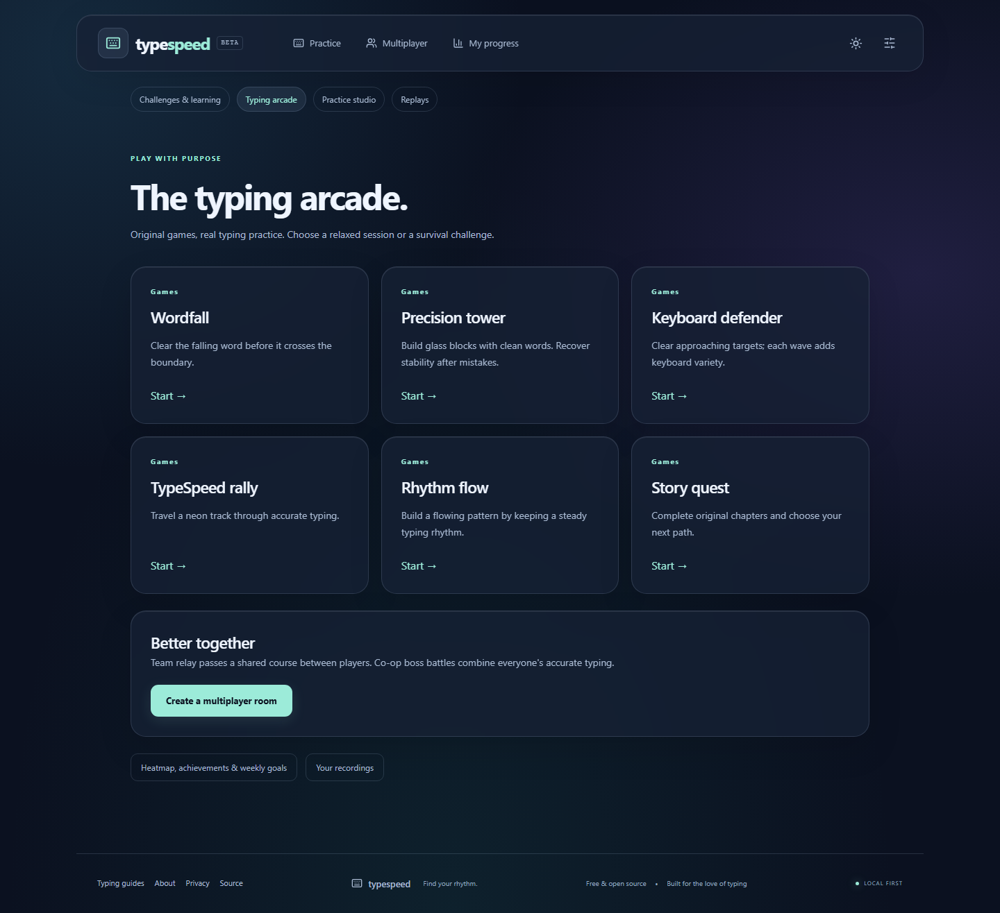

# TypeSpeed

**Find your flow. Practice with purpose. Race with friends.**

A free, open-source typing practice and private multiplayer platform. Start typing without an account, track your progress on your device, or invite friends to a host-approved race.

[**Launch TypeSpeed ↗**](https://typespeed-a.vercel.app/) · [Features](#features) · [Quick start](#quick-start) · [Multiplayer](#how-multiplayer-works) · [Documentation](#documentation)

> **Live app:** [typespeed-a.vercel.app](https://typespeed-a.vercel.app/). The frontend is hosted on Vercel; multiplayer uses a separate persistent backend. No account, database or paid API is required by the application. Public hosting may have provider usage limits.


## Features

### Solo practice

- **Timed tests:** 15, 30, 60, and 120 seconds.
- **Three difficulty levels:** easy, medium, and hard, using bundled English word banks.
- **Content options:** optional punctuation and numbers.
- **Click-to-type passage:** click or tap the words to focus the caret; the timer starts with the first keystroke. Correct/incorrect character highlighting, automatic scrolling, Backspace corrections and restart are built in, without a separate visible input box.
- **Performance metrics:** live WPM and accuracy; completed results include validated WPM, raw WPM, correct characters, incorrect attempts, uncorrected errors, and backspaces.
- **Local analytics:** recent sessions, best and average WPM, average accuracy, completed-test count, and a recent-speed chart.
- **Personal appearance:** premium glass panels, ambient gradients, and dark/light themes saved in the browser.
- **Practice preferences:** duration, difficulty, punctuation, and number settings survive reloads.
- **Session charts:** per-test speed graphs with accessible data tables.
- **Independent operation:** solo practice does not need the multiplayer backend.

### Private multiplayer

- Guest-only rooms for **2–8 players**, with no registration or email address.
- Cryptographically generated room codes and copyable invitation links.
- **Mandatory host approval:** requesting guests stay outside the lobby until approved by the server.
- Host controls for approving/rejecting requests, removing players, editing settings, starting races, and closing rooms.
- Ready states and connection indicators for approved players.
- **30-, 60-, and 120-second races**, with shared passages and a server-controlled countdown.
- Live player metrics and progress indicators, broadcast at four updates per second.
- Ordered, server-validated typing operations; final scores are calculated independently of client-reported values.
- Final rankings, a **95% minimum accuracy requirement** for winning, and shared ranks for exact ties.
- Rematches without another approval request.
- Temporary session recovery on refresh, reconnect handling, request expiration, idle-room cleanup, and host transfer after a disconnect grace period.

### Interface and privacy

Responsive glassmorphism layouts with a unified dark/light material system, desktop navigation, a mobile menu and grouped footer links. Keyboard-accessible controls, reduced-motion and reduced-transparency support, and local system fonts keep practice focused. Practice history stays in the current browser; multiplayer rooms and sessions are held in server memory. No third-party analytics or remote content service is required.

### Challenges, learning and arcade

- **Daily trio:** seeded sprint, accuracy and punctuation challenges, with saved first/best attempts.
- **Personal training:** mistake drills, adaptive difficulty, five-minute practice plans and ghost races against recorded performances.
- **Skill challenges:** Clean 100, Perfect 25, Consistency Run, Punctuation Pro, Number Sprint, multiline Code Sprint and Personal Best Ladder.
- **Solo games:** Wordfall, Precision Tower, Keyboard Defender, TypeSpeed Rally, Rhythm Flow and a branching original Story Quest.
- **Cooperative rooms:** server-enforced Team Relay turns and shared boss battles, alongside competitive racing.
- **Learning:** six beginner lessons, custom text, and Spanish, French and German word practice.
- **Practice studio:** keyboard error heatmaps, slow-transition reports, achievements, flexible weekly goals, caret/font/sound settings and cosmetic accent unlocks.
- **Replay and sharing:** playback with correction markers, full-passage friend challenges, downloadable result cards, and validated studio progress backups.
- **Offline solo use:** production builds cache the solo application after an online visit; multiplayer still needs the backend.

See [activity rules and storage boundaries](docs/learning-and-games.md) for exact behavior. Local and shared challenge scores are unverified; cooperative room outcomes are calculated by the server.




## Quick start

### Prerequisites

- **Node.js 22.12 or newer**; Node.js 24 is the tested runtime.
- **npm**, included with a standard Node.js installation.
- **Git** and a modern desktop browser with a physical keyboard.

### Install and run

```bash
git clone https://github.com/Mr-Ankitpandey/TypeSpeed.git
cd TypeSpeed
npm ci
npm run dev
```

Open **[http://127.0.0.1:5173](http://127.0.0.1:5173)**. The frontend runs on port `5173`; the backend runs on port `3001`.

For solo practice only:

```bash
npm run dev:web
```

The development frontend proxies `/socket.io` requests to the local backend. Initial dependency downloads require internet access; the core application runs locally without external services.

## How multiplayer works

1. Open **Multiplayer**, enter your display name, choose the settings, and create a room.
2. Share the room code or invitation link with a friend.
3. Your friend enters a display name and selects **Request to join**.
4. Approve the request from the host's lobby. Until approval, the guest receives no protected room or race content.
5. Both players select **Ready to race**. The host can start once at least two approved players are connected and everyone is ready.
6. Type the shared passage after the synchronized countdown.
7. Review the server-calculated results, then select **Rematch / return to lobby** to race again.

To test two players on one computer, use separate browser profiles or a normal window and an incognito window. Sessions are tab-scoped; a resumed credential can control only one active socket at a time.

## Scoring

| Metric             | Calculation                                                      |
| ------------------ | ---------------------------------------------------------------- |
| Validated WPM      | Correctly retained characters ÷ 5 ÷ official duration in minutes |
| Raw WPM            | All printable attempts ÷ 5 ÷ official duration in minutes        |
| Accuracy           | Correct printable attempts ÷ total printable attempts × 100      |
| Uncorrected errors | Retained characters that do not match the passage                |

Correcting a mistake removes the retained error but **does not erase the incorrect attempt** from accuracy. Backspaces are tracked separately. Zero printable attempts produce 0% accuracy.

Rankings compare qualification at **95% accuracy**, then validated WPM, accuracy, and fewer incorrect attempts. Comparisons use full precision; rounding is for display only. Exact ties share a rank. If nobody qualifies, the results show **No qualifying winner**.

The server accepts input by receipt time within the official race window. Client timestamps and client scores are not trusted. See [scoring rules](docs/scoring.md) for the complete policy.

## Technology stack

| Area       | Technologies                                                |
| ---------- | ----------------------------------------------------------- |
| Frontend   | React, TypeScript, Vite, Tailwind CSS, React Router, Lucide |
| Backend    | Node.js, TypeScript, Fastify, Socket.IO                     |
| Validation | Zod schemas and shared TypeScript contracts                 |
| Storage    | Browser localStorage/sessionStorage and server-side Maps    |
| Testing    | Vitest and Playwright                                       |
| Tooling    | npm workspaces, ESLint, Prettier, tsup                      |

## Development commands

Run these commands from the repository root:

| Command                              | Purpose                                                   |
| ------------------------------------ | --------------------------------------------------------- |
| `npm run dev`                        | Start frontend and backend together                       |
| `npm run dev:web`                    | Start only the frontend                                   |
| `npm run dev:server`                 | Start only the backend                                    |
| `npm run typecheck`                  | Check strict TypeScript types                             |
| `npm run lint`                       | Run ESLint                                                |
| `npm run format`                     | Format project files with Prettier                        |
| `npm test`                           | Run engine, room-service, and Socket.IO integration tests |
| `npm run test:e2e`                   | Run Playwright browser tests                              |
| `npm run test:offline`               | Build and test production offline solo navigation         |
| `npm run build`                      | Type-check and build both applications                    |
| `npm run start -w @typespeed/server` | Start the built backend                                   |
| `npm run preview -w @typespeed/web`  | Preview the built frontend locally                        |

Install the test browser before running browser tests:

```bash
npx playwright install chromium
npm test
npm run test:e2e
```

Tests cover corrections and scoring, rankings, authorization, approval and rejection, capacity checks, replayed/out-of-order input, reconnection, cleanup, browser history, responsive layouts, long-passage scrolling, race/rematch, cooperative rounds, learning activities, replays, backups and offline navigation. See [verification notes](docs/verification.md) for milestone results and boundaries.

## Documentation

- [Product requirements](docs/requirements.md)
- [Architecture and lifecycle](docs/architecture.md)
- [Scoring rules](docs/scoring.md)
- [Multiplayer command and event contracts](docs/multiplayer-events.md)
- [Deployment guide](docs/deployment.md)
- [SEO and Vercel configuration](docs/seo.md)
- [Interface design decisions](docs/ui-design.md)
- [Learning, challenges and games](docs/learning-and-games.md)
- [Verification notes](docs/verification.md)

## Author

**Created and maintained by [Ankit Pandey](https://github.com/Mr-Ankitpandey).**

Project repository: [Mr-Ankitpandey/TypeSpeed](https://github.com/Mr-Ankitpandey/TypeSpeed).

Project website: [typespeed-a.vercel.app](https://typespeed-a.vercel.app/).

## License

Copyright © 2026 **Ankit Pandey**. Released under the [MIT License](LICENSE). Third-party dependencies retain their respective licenses.
