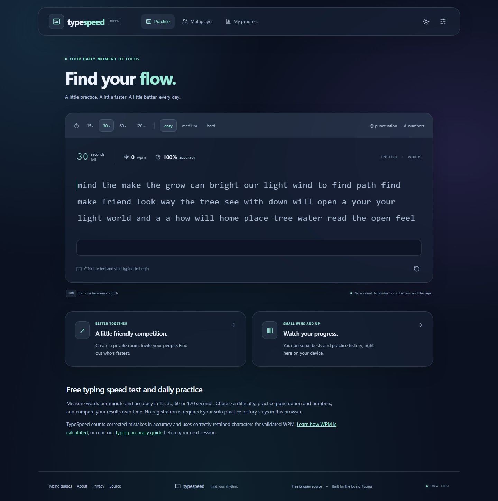

# TypeSpeed

**Find your flow. Practice with purpose. Race with friends.**

A free, open-source typing practice and private multiplayer platform by **[Ankit Pandey](https://github.com/Mr-Ankitpandey)**. Start typing without an account, track your progress on your device, or invite friends to a host-approved race.

[Features](#features) · [Quick start](#quick-start) · [Multiplayer](#how-multiplayer-works) · [Architecture](#project-structure) · [Documentation](#documentation)

> **Status: local MVP.** Solo practice and the core multiplayer flow are implemented and tested. Public deployment hardening and broader device support are still on the roadmap. No database, paid API, or managed service is required to run the application.



## Features

### Solo practice

- **Timed tests:** 15, 30, 60, and 120 seconds.
- **Three difficulty levels:** easy, medium, and hard, using bundled English word banks.
- **Content options:** optional punctuation and numbers.
- **Immediate feedback:** correct/incorrect character highlighting, visible caret, automatic scrolling, Backspace corrections, and restart.
- **Performance metrics:** live WPM and accuracy; completed results include validated WPM, raw WPM, correct characters, incorrect attempts, uncorrected errors, and backspaces.
- **Local analytics:** recent sessions, best and average WPM, average accuracy, completed-test count, and a recent-speed chart.
- **Personal appearance:** premium glass panels, ambient gradients, and dark/light themes saved in the browser.
- **Practice preferences:** duration, difficulty, punctuation, and number settings survive reloads.
- **Session charts:** per-test speed graphs with accessible data tables.
- **Independent operation:** solo practice does not need the multiplayer backend.

### Private multiplayer

- Guest-only rooms for **2–8 players**, with no registration or email address.
- Cryptographically generated room codes and copyable invitation links.
- **Mandatory host approval:** requesting guests stay outside the lobby until approved by the server.
- Host controls for approving/rejecting requests, removing players, editing settings, starting races, and closing rooms.
- Ready states and connection indicators for approved players.
- **30-, 60-, and 120-second races**, with shared passages and a server-controlled countdown.
- Live player metrics and progress indicators, broadcast at four updates per second.
- Ordered, server-validated typing operations; final scores are calculated independently of client-reported values.
- Final rankings, a **95% minimum accuracy requirement** for winning, and shared ranks for exact ties.
- Rematches without another approval request.
- Temporary session recovery on refresh, reconnect handling, request expiration, idle-room cleanup, and host transfer after a disconnect grace period.

### Interface and privacy

Responsive glassmorphism layouts, keyboard-accessible controls, reduced-motion and reduced-transparency support, and local system fonts. Practice history stays in the current browser; multiplayer rooms and sessions are held in server memory. No third-party analytics or remote content service is required.

### Search visibility

Public pages are prerendered to readable HTML with unique titles and descriptions, share metadata, canonical URLs, structured data, a sitemap, and robots.txt. Original typing guides explain speed and accuracy. Personal pages and room links opt out of indexing. Production URL metadata is generated only when the actual domain is configured; search rankings are not guaranteed.

## Quick start

### Prerequisites

- **Node.js 22.12 or newer**; Node.js 24 is the tested runtime.
- **npm**, included with a standard Node.js installation.
- **Git** and a modern desktop browser with a physical keyboard.

### Install and run

```bash
git clone https://github.com/Mr-Ankitpandey/TypeSpeed.git
cd TypeSpeed
npm ci
npm run dev
```

Open **[http://127.0.0.1:5173](http://127.0.0.1:5173)**. The frontend runs on port `5173`; the backend runs on port `3001`.

For solo practice only:

```bash
npm run dev:web
```

The development frontend proxies `/socket.io` requests to the local backend. Initial dependency downloads require internet access; the core application runs locally without external services.

## How multiplayer works

1. Open **Multiplayer**, enter your display name, choose the settings, and create a room.
2. Share the room code or invitation link with a friend.
3. Your friend enters a display name and selects **Request to join**.
4. Approve the request from the host's lobby. Until approval, the guest receives no protected room or race content.
5. Both players select **Ready to race**. The host can start once at least two approved players are connected and everyone is ready.
6. Type the shared passage after the synchronized countdown.
7. Review the server-calculated results, then select **Rematch / return to lobby** to race again.

To test two players on one computer, use separate browser profiles or a normal window and an incognito window. Sessions are tab-scoped; a resumed credential can control only one active socket at a time.

## Scoring

| Metric             | Calculation                                                      |
| ------------------ | ---------------------------------------------------------------- |
| Validated WPM      | Correctly retained characters ÷ 5 ÷ official duration in minutes |
| Raw WPM            | All printable attempts ÷ 5 ÷ official duration in minutes        |
| Accuracy           | Correct printable attempts ÷ total printable attempts × 100      |
| Uncorrected errors | Retained characters that do not match the passage                |

Correcting a mistake removes the retained error but **does not erase the incorrect attempt** from accuracy. Backspaces are tracked separately. Zero printable attempts produce 0% accuracy.

Rankings compare qualification at **95% accuracy**, then validated WPM, accuracy, and fewer incorrect attempts. Comparisons use full precision; rounding is for display only. Exact ties share a rank. If nobody qualifies, the results show **No qualifying winner**.

The server accepts input by receipt time within the official race window. Client timestamps and client scores are not trusted. See [scoring rules](docs/scoring.md) for the complete policy.

## Technology stack

| Area       | Technologies                                                |
| ---------- | ----------------------------------------------------------- |
| Frontend   | React, TypeScript, Vite, Tailwind CSS, React Router, Lucide |
| Backend    | Node.js, TypeScript, Fastify, Socket.IO                     |
| Validation | Zod schemas and shared TypeScript contracts                 |
| Storage    | Browser localStorage/sessionStorage and server-side Maps    |
| Testing    | Vitest and Playwright                                       |
| Tooling    | npm workspaces, ESLint, Prettier, tsup                      |

The application uses free, open-source dependencies and a single persistent backend process. Docker, databases, queues, and managed WebSocket providers are not required.

## Project structure

```text
TypeSpeed/
├── apps/
│   ├── web/
│   │   └── src/
│   │       ├── components/          # Reusable typing UI
│   │       ├── features/
│   │       │   ├── typing/          # Solo practice
│   │       │   └── multiplayer/     # Room and race screens
│   │       ├── lib/                 # Browser storage helpers
│   │       ├── main.tsx             # Routes, analytics, settings, app shell
│   │       └── styles.css
│   └── server/
│       └── src/
│           ├── rooms/              # Room/session/race lifecycle
│           ├── index.ts            # HTTP and Socket.IO adapters
│           └── realtime.test.ts
├── packages/
│   ├── typing-engine/              # Pure typing, content, scoring, ranking
│   └── shared/                     # Runtime schemas and event contracts
├── tests/                          # Browser acceptance tests
├── docs/                           # Architecture, requirements, deployment
├── package.json
└── package-lock.json
```

The same framework-independent engine powers solo feedback and authoritative multiplayer scoring. The backend owns permissions, membership, timing, accepted operations, and final race results.

## Development commands

Run these commands from the repository root:

| Command                              | Purpose                                                   |
| ------------------------------------ | --------------------------------------------------------- |
| `npm run dev`                        | Start frontend and backend together                       |
| `npm run dev:web`                    | Start only the frontend                                   |
| `npm run dev:server`                 | Start only the backend                                    |
| `npm run typecheck`                  | Check strict TypeScript types                             |
| `npm run lint`                       | Run ESLint                                                |
| `npm run format`                     | Format project files with Prettier                        |
| `npm test`                           | Run engine, room-service, and Socket.IO integration tests |
| `npm run test:e2e`                   | Run Playwright browser tests                              |
| `npm run build`                      | Type-check and build both applications                    |
| `npm run start -w @typespeed/server` | Start the built backend                                   |
| `npm run preview -w @typespeed/web`  | Preview the built frontend locally                        |

Install the test browser before running browser tests:

```bash
npx playwright install chromium
npm test
npm run test:e2e
```

Tests cover corrections and scoring, rankings, authorization, approval and rejection, capacity checks, replayed/out-of-order input, reconnection, cleanup, browser history, responsive layouts, long-passage scrolling, and a two-player race/rematch flow. See [verification notes](docs/verification.md) for the initial milestone's results and boundaries.

## Configuration and deployment

| Variable          | Used by        | Default / purpose                                                                                        |
| ----------------- | -------------- | -------------------------------------------------------------------------------------------------------- |
| `PORT`            | Backend        | `3001`                                                                                                   |
| `HOST`            | Backend        | `127.0.0.1`                                                                                              |
| `ALLOWED_ORIGINS` | Backend        | `http://127.0.0.1:5173,http://localhost:5173`; comma-separated exact frontend origins                    |
| `VITE_SERVER_URL` | Frontend build | Unset: connect through the same origin; set for a separately hosted backend                              |
| `SITE_URL`        | Frontend build | Actual public HTTPS origin for canonical URLs and sitemap; falls back to Vercel's production project URL |

Set backend variables in the process environment before starting it. The backend does not automatically load `.env` files. Vite handles frontend environment variables at development/build time.

Build outputs are `apps/web/dist` and `apps/server/dist`. Production self-hosting requires static hosting with SPA fallback, a persistent Node process, and HTTPS/WebSocket proxy configuration. Local production preview on port `4173` also requires that origin in `ALLOWED_ORIGINS`.

The included `vercel.json` configures frontend builds, static pages, private route indexing headers, and room routing. No public deployment has been performed. The in-memory multiplayer backend requires a persistent process. See the [SEO and Vercel guide](docs/seo.md) and [deployment guide](docs/deployment.md).

## Current limitations

- Server restarts remove all rooms, guest sessions, and temporary multiplayer results.
- Practice history stores the latest **200 tests** in the current browser. Clearing browser data removes it; cross-device sync is not implemented.
- Input supports printable English ASCII characters and Backspace. Paste, arbitrary cursor editing, and arbitrary IME text transformations are not supported. Mobile keyboards can use the native typing input field. Native input is covered by browser tests; device-specific keyboard behavior may vary.
- Receipt-time scoring can disadvantage high-latency connections. Rate limits detect obvious bursts but do not make browser races cheat-proof.
- The current release targets local use and a single backend instance. Public deployment needs further operational and security hardening.

## Roadmap

- [x] Strict TypeScript workspace and reusable typing engine
- [x] Solo practice, results, browser history, analytics, and themes
- [x] Guest rooms with backend-enforced host approval
- [x] Synchronized races, server-side scoring, results, and rematches
- [x] Core automated tests and responsive interface
- [x] Persist practice-setting preferences
- [x] Glassmorphism interface with dark/light and accessibility preferences
- [x] Prerendered public pages, SEO metadata, sitemap generation, and Vercel frontend configuration
- [ ] Expand latency, interruption, and long-running resource tests
- [ ] Improve assistive-technology and mobile keyboard support
- [ ] Harden and document a public self-hosted deployment
- [ ] Explore weak-key exercises, ghost races, and additional content modes

## Documentation

- [Product requirements](docs/requirements.md)
- [Architecture and lifecycle](docs/architecture.md)
- [Scoring rules](docs/scoring.md)
- [Multiplayer command and event contracts](docs/multiplayer-events.md)
- [Deployment guide](docs/deployment.md)
- [SEO and Vercel configuration](docs/seo.md)
- [Verification notes](docs/verification.md)

## Author

**Created and maintained by [Ankit Pandey](https://github.com/Mr-Ankitpandey).**

Project repository: [Mr-Ankitpandey/TypeSpeed](https://github.com/Mr-Ankitpandey/TypeSpeed).

## License

Copyright © 2026 **Ankit Pandey**. Released under the [MIT License](LICENSE). Third-party dependencies retain their respective licenses.

### Core feature completion

Per-test speed charts include an accessible data table. Live race standings update their rank order during the race. A native text-input field supports mobile keyboard entry and Backspace corrections without enabling paste.
